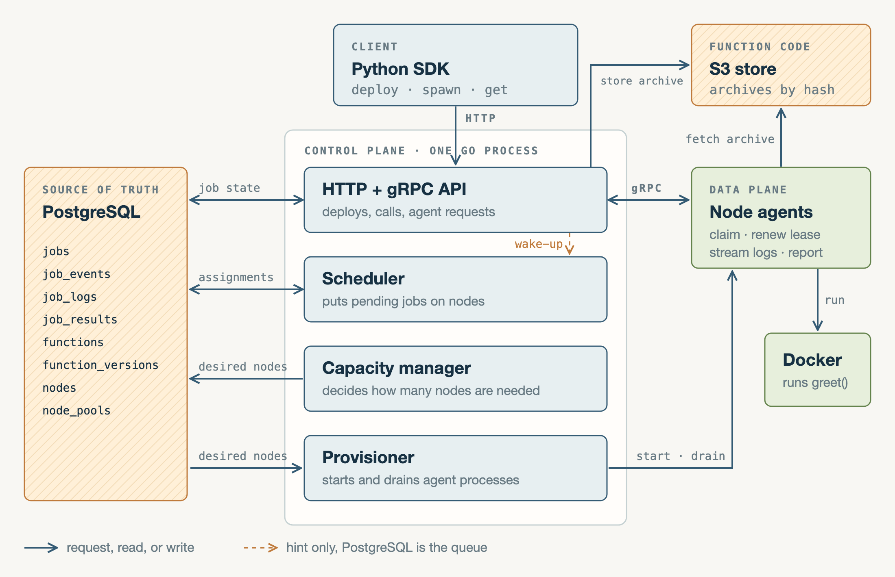
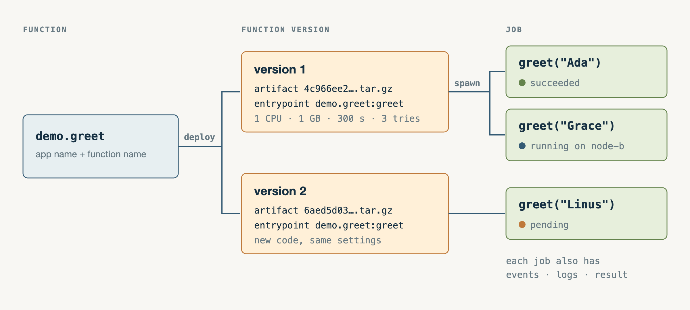
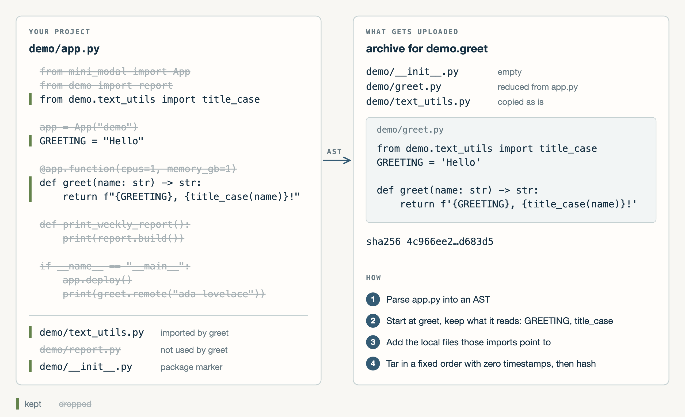
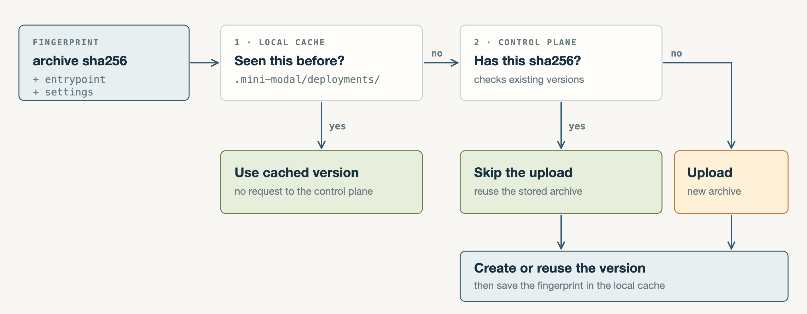
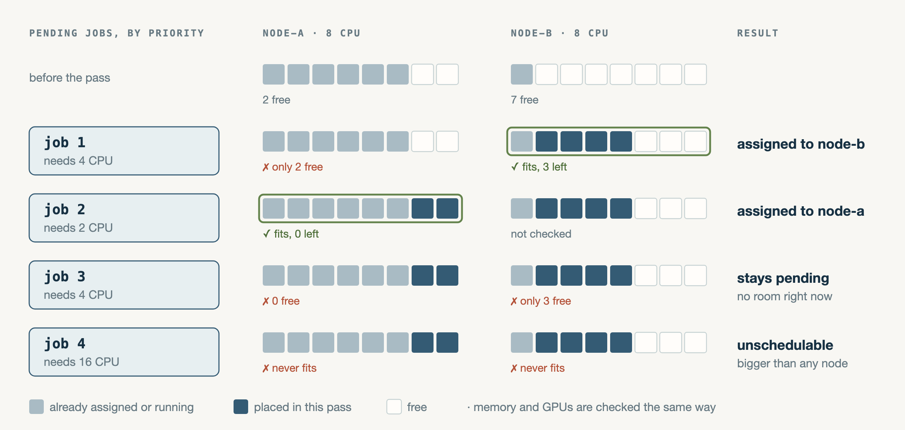
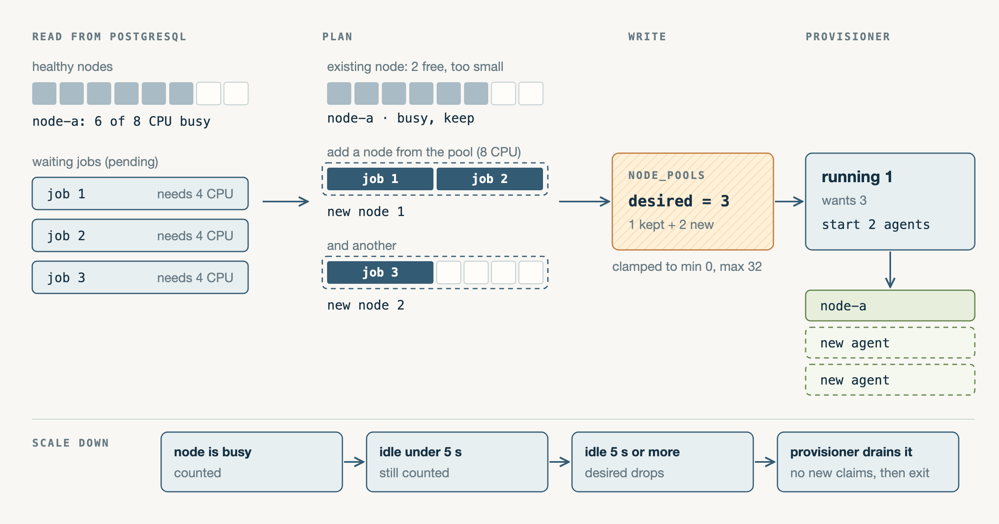

# mini-modal (distributed job scheduler)

A small, self-hosted take on [Modal](https://modal.com)'s function invocation workflow.
You decorate a function with `@app.function()`, and at runtime this code will run on a separate machine.

Goals:
- Implement distributed systems techniques
- Learn Go
- Learn performance characteristics

It runs on one machine and is not meant for real workloads. There is no
authentication, only one control-plane process, and Docker is not a security
boundary for untrusted code.

```python
from mini_modal import App

app = App("demo")

@app.function(cpus=1, memory_gb=1)
def greet(name: str) -> str:
    return f"Hello, {name}!"

if __name__ == "__main__":
    app.deploy()
    call = greet.spawn("Ada")     # returns as soon as the job is stored
    print(call.get())             # waits for the result
    print(greet.remote("Grace"))  # spawn and wait in one call
```

## Dashboard


Real-time version: [demo.mp4](docs/blog/assets/demo.mp4)

The control plane serves a small dashboard on port 8080. It polls the HTTP API every second, so everything on it comes straight from PostgreSQL and the in-memory heartbeats.

- **Overview:** total jobs, active jobs (assigned, running, or stopping), waiting jobs (pending or blocked), and healthy nodes (heartbeat within the last 5 s).
- **Resources:** used versus total CPU, memory, and GPUs across the healthy nodes.
- **Functions:** the deployed functions and their versions, plus forms to upload source, deploy a version, and create a job by hand.
- **Jobs:** every job with its state, the node it was placed on, its function version, how often it ran, and its lease. You can search by job or node ID and filter by state.
- **Nodes:** each agent with its free CPU and memory and whether it is healthy.
- **Activity:** the latest status changes the dashboard has seen.
- **Job page:** click a job to see its logs per attempt, the return value, the full record, and the event timeline.

## Supported features

**Deploying functions**
- Uploading an artifact
- Tree-shaken artifacts and skipping unchanged deploys
- Immutable function versions

**Jobs**
- Idempotent job submission
- Job priorities
- Job timeouts
- Cancellation of a job

**Scheduling and capacity**
- First-fit scheduling
- Capacity management and provisioning on backlog
- Node registration and heartbeats
- Graceful node draining

**Execution**
- Docker execution with CPU and memory limits
- Live log streaming from the node, stored per attempt

**Failure handling**
- Leases and fencing tokens
- Retrying with a fixed backoff

**Observability and tooling**
- Job lifecycle event history
- Prometheus metrics and a Grafana dashboard
- Web dashboard for deploying, invoking, and inspecting jobs
- Load simulator and benchmark harness

## The Plan



### Data structures



- What's a function:
  ```go
  // internal/store/postgres/sqlc/models.go
  type Function struct {
      ID        string // "demo.greet"
      CreatedAt int64
  }
  ```
  This is the unique identifier for every decorated function you have. In our simple case, it's the app name plus the function name, like `demo.greet`.

- What's a function_version:
  ```go
  type FunctionVersion struct {
      ID                  string
      FunctionID          string // "demo.greet"
      ArtifactKey         string // ".../artifacts/<sha256>.tar.gz" in S3
      Image               string // "mini-modal-python:dev"
      GpuType             string
      Gpus                int64
      Cpus                int64
      MemoryGb            int64
      MaxAttempts         int64
      RetryBackoffSeconds int64
      CreatedAt           int64
      Entrypoint          string // "demo.greet:greet"
      TimeoutSeconds      int64
  }
  ```
  This allows us to save multiple versions of a function if something changes. It also stores the requirements of the invocation, like how much RAM, CPU, or GPUs it needs.

- What's a job:
  ```go
  type Job struct {
      ID                string
      Priority          int64
      Status            string          // pending, assigned, running, succeeded, ...
      NodeID            string          // set by the scheduler
      Attempt           int64           // +1 on every assignment
      LeaseExpiresAt    int64           // the agent must claim or renew before this
      UpdatedAt         int64
      NextAttemptAt     int64           // retry backoff
      LastError         string
      ExecutionAttempts int64           // +1 on every claim
      FunctionVersionID string          // which version to run
      InputJson         json.RawMessage // {"args": ["Ada"], "kwargs": {}}
      CreatedAt         int64
  }
  ```
  This is an execution that will run on one of our agents.

- What's a node_pool:
  ```go
  type NodePool struct {
      ID                 string // "local-dev"
      GpuType            string
      GpusPerNode        int64
      CpusPerNode        int64  // 8
      MemoryGbPerNode    int64  // 16
      MinNodes           int64  // 0
      MaxNodes           int64  // 32
      DesiredNodes       int64  // written by the capacity manager
      IdleTimeoutSeconds int64  // 5
      AutoscaleEnabled   bool
  }
  ```
  This is a group of nodes that all look the same. It stores how big each node is (CPU, RAM, GPUs) and how many nodes we want. The capacity manager writes the desired count here, and the provisioner reads it to start or drain nodes.

- What's a node:
  ```go
  // Heartbeats are tracked in control-plane memory, not in this table.
  type Node struct {
      ID            string // "node-<uuid>"
      PoolID        string // "local-dev"
      GpuType       string
      TotalGpus     int64
      TotalCpus     int64
      TotalMemoryGb int64
      ShouldDrain   bool   // set when scaling down
  }
  ```
  This is one worker that runs our jobs. In our simple case, it's an agent process that registers with its pool and how much CPU, RAM, and GPUs it has. When we scale down, we set `ShouldDrain` so it stops taking new jobs and exits after the running ones finish.

### Python SDK

Just a small SDK that allows us to upload the decorated function. Then you can call the function with `.spawn()` and `.get()`.
It basically mimics Modal's SDK, but with a little twist. What Modal does is package every file where you have a decorated function and deploy it, even if the code doesn't have anything to do with the decorated function.

Example:

```python
# demo/app.py, deployed with: modal deploy -m demo.app
import modal

from demo import report
from demo.text_utils import title_case

app = modal.App("demo")

GREETING = "Hello"


@app.function()
def greet(name: str) -> str:
    return f"{GREETING}, {title_case(name)}!"


def print_weekly_report():
    print(report.build())


@app.local_entrypoint()
def main():
    print(greet.remote("ada lovelace"))
```

What ends up in the container:

```text
demo/              the whole package, because greet is defined in it
├── __init__.py
├── app.py         all of it, including print_weekly_report and main
├── report.py      greet never uses this
└── text_utils.py
```

The problem that arises here is that `.deploy()` is triggered even if you change anything not related to your function, even function invocations, because the SDK hashes the contents of the artifact.

So my idea was to use an AST and tree shaking to only upload the parts that are necessary for the invocation. Because of dynamic imports, we still need a way to include some modules ourselves (`include_modules`).





This has the effect that unnecessary deploys are reduced. They are a big problem, because when you are developing the application, an additional 2 s of reload time hurts the DX drastically.

Once the function is deployed, `spawn()` sends the call to the control plane over HTTP.

### Control plane

A simple HTTP API that handles the lifecycle events of a function (deployment, submission, cancellation, status reports, etc.) plus function versioning.

So the control plane will validate the job and put it into our shared DB with the status `pending`, so that it can be picked up by our scheduler.

The request returns right here, so `spawn()` gives you a job handle without waiting for a node. A small wake-up signal tells the scheduler there is new work, and if that signal is missed, the scheduler's pass every second still finds the job.

### Scheduler

For this case, a simple first-fit placement scheduler. It takes the pending jobs, checks the currently available nodes, and tries to place each job on one of them.



If no node has room, the job simply stays `pending`. These waiting jobs are what the capacity manager looks at next.

### Capacity manager

The capacity manager's job is to check the current demand (the pending jobs), compare it with the free resources, and calculate the target state of resources. Because we want to have a small leeway, a next step would be to also keep a buffer of warm nodes so we can handle spikes.



It only writes this target into `node_pools`. Starting the nodes is the provisioner's job.

### Provisioning

This service's job is to fulfill the target state that the capacity manager planned. It starts the nodes in each node pool necessary to meet the target state. In this example, it just runs the agent binary as a child process. In a production system, this would be replaced with bare-metal servers.

Each new agent registers with the control plane and starts sending heartbeats. From then on, the scheduler can place jobs on it.

### Node (data plane)

The actual service that is responsible for taking the assigned jobs and running them. For the local case, I just spawn Docker containers, but in production they would be replaced with microVMs (with snapshots) to improve latency.

It claims its job over gRPC, downloads the archive from S3, runs the function, streams the logs back, renews its lease every 5 seconds, and reports the result.

## Benchmarks

Because i wanted so also see the perfomance characteristics i created a benchmark to test see how much it could perform.

### Setup

| Part | Where it runs | Limit |
| --- | --- | --- |
| Control plane (+ 16 agents in end-to-end runs) | one container | 4 CPUs, 6 GiB |
| PostgreSQL 15 | own container | 4 CPUs, 4 GiB |
| Load generator | own container in end-to-end runs | 2 CPUs, 2 GiB |
| MinIO | own container | |

There are two kinds of runs:

- **Submission:** 10,000 jobs sent over HTTP by 1 or 32 concurrent clients. Only the request is timed, until the job is stored as `pending`. No agents run.
- **End to end:** 100,000 calls of a hello-world Python function at a fixed rate. Each call is stored, scheduled, claimed by an agent, downloads the archive, runs as a host process (not Docker), and reports a JSON result.

Everything runs in Docker on one Mac. Submission numbers are the mean of three runs; each end-to-end rate is a single run.

### Results

**Submission (control plane only)**

| HTTP clients | Jobs stored per second | p99 per request |
| ---: | ---: | ---: |
| 1 | 1,869 | 2.0 ms |
| 32 | 11,384 | 9.5 ms |

**End to end (hello-world function)**

| Submitted/s | Completed/s | Queue empty after last submit | Job p99 | App CPU (of 4) | PostgreSQL CPU (of 4) |
| ---: | ---: | ---: | ---: | ---: | ---: |
| 249.9 | 246.0 | 6.4 s | 61.4 s | 3.63 | 0.76 |
| 274.9 | 242.2 | 49.1 s | 268.0 s | 3.64 | 0.80 |

- **About 11,400 jobs stored per second** with 32 clients, and a burst of 100,000 jobs was accepted in 8.6 s.
- **250 calls/s end to end** over 100,000 calls. The queue was empty 6.4 s after the last submission, and all 200,000 calls in both runs succeeded.
- **The nodes are the limit, not the control plane.** Storing a job is about 45 times faster than running one. End-to-end throughput follows how fast the agents claim work: 8 agents polling every 50 ms can start at most 160 calls/s and reached 157/s. 16 agents reached about 250/s while sharing the same 4 CPUs with the control plane.
- **PostgreSQL used under 1 of its 4 cores** in the end-to-end runs.

The [submission snapshot](docs/benchmark-2026-10-03.md) and the [end-to-end report](docs/benchmark-hello-process-2026-10-03.md) have every run and the full setup, the [methodology](docs/benchmarking.md) explains how to reproduce them, and raw results are [indexed here](benchmarks/results/README.md).

## Limits

- One control-plane process keeps node heartbeats in memory. Running several
  replicas would need shared health state and coordination.
- The provisioner starts agent processes on the same machine. It stands in for
  a VM provisioner.
- Functions run in plain Docker containers, not microVMs. GPU requests affect
  placement, but no real GPUs are attached.
- Scheduling and capacity planning scan PostgreSQL rows directly. There are no
  quotas, fair-share scheduling, or warm pools.
- PostgreSQL is the only supported database. Older benchmark results used
  SQLite.
- Execution is at least once. If a lease expires, the job can run again, so
  functions should be safe to run twice.
- Agents poll for work every 50 ms instead of getting assignments pushed to
  them. That polling caps how fast one agent can start jobs.
- Retries wait a fixed backoff. There is no exponential backoff or jitter.
- Only Python functions with JSON arguments and results. Third-party libraries
  must already be in the worker image.
- The packager follows top-level functions, assignments, and imports. A class
  used by the function is not included yet.
- No cron schedules or job dependencies. A job runs as soon as there is room.
- Jobs, logs, and events are never cleaned up, so the database keeps growing.
- No authentication. Anyone who can reach the API can upload and run code.

## Learnings

**Distributed systems**
- Accepting a job and running it are two different promises. Storing the job and returning right away made submission fast; moving scheduling out of the request alone raised admission throughput by about 55%.
- The database is the queue. The wake-up signal is only a hint, so losing one never loses a job.
- Workers can disappear at any time. A lease that is not renewed gives the job back, and the attempt number makes sure a late result from an old worker is rejected. That gives at-least-once, not exactly-once.
- Desired state and actual state are separate. The capacity manager writes what we want, and the provisioner keeps working until it is true, the same idea as Kubernetes controllers.
- Retries need idempotency. Sending the same job ID twice returns the same job instead of running it twice.

**Performance**
- Measure before guessing. The first 100,000-job run stalled at 46,548 jobs after 15 minutes: every scheduler pass read all pending rows while holding a lock. Reading them in batches of 10,000 with an index let the next run finish all 100,000.
- More workers are not always faster. On 4 CPUs, going past 16 agents did not increase throughput.
- Benchmarks on a laptop are noisy. Running each scenario three times and comparing the means was needed to tell real changes from noise.

**Go**
- `context.Context` carries timeouts and cancellation through the whole call. A job timeout is a context deadline, and a cancel request reaches the running job through the lease renewal.
- A channel with room for one message is enough to merge many wake-ups into a single scheduler pass without blocking the request.
- sqlc keeps the queries as plain SQL and generates typed Go code for them.
- gRPC client streaming made live logs from the agent to the control plane simple.
