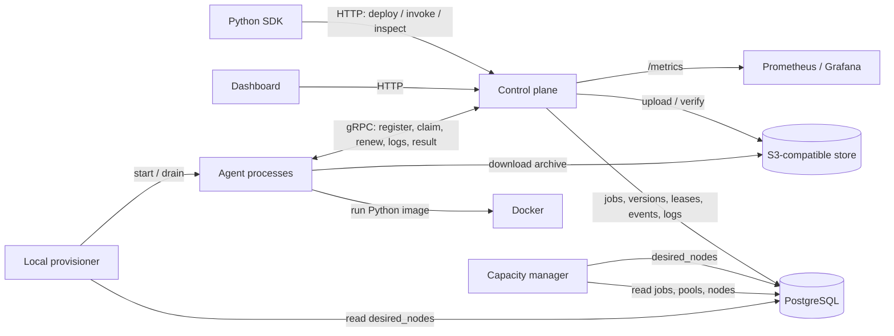

# System design

This documents the current implementation. It describes a local prototype,
not a target production architecture.

## High-level design

The HTTP API, gRPC server, scheduler, capacity manager, and local provisioner
currently run inside one control-plane process. Agents are separate OS
processes. PostgreSQL is the durable source of truth; a buffered wakeup
channel merely prompts scheduling and is not a job queue. The object store
holds function archives, not job state.

## State and ownership

| State | Owner | Durability |
| --- | --- | --- |
| Functions and immutable versions | PostgreSQL | Durable |
| Jobs, attempts, assignment leases, node pools, desired counts | PostgreSQL | Durable |
| Job events, logs, and JSON results | PostgreSQL | Durable |
| Function archives | S3-compatible object store | Durable while bucket persists |
| Last agent heartbeat | Control-plane memory | Lost on restart |
| Spawned local process handles and idle timers | Provisioner/capacity memory | Lost on restart |
| SDK deployment fingerprints | Client filesystem | Local cache, disposable |

## Main paths

**Deploy.** The SDK builds a function-specific archive and fingerprints it.
The control plane stores the archive by content hash, verifies its key, and
records a version with image, entrypoint, resources, timeout, and retry
settings. Invocation jobs refer to a version ID rather than copying settings
into the request.

**Submit and place.** HTTP submission commits a job and event. It sends a
non-blocking wakeup; a one-second ticker also runs scheduling. The scheduler
reads eligible pending jobs in priority order, reconstructs free capacity
from healthy nodes and active jobs, and assigns first fit. A job that cannot
fit on any current node may become `unschedulable`; node registration puts it
back into `pending`.

**Add capacity.** Independently, the capacity manager compares waiting work
with real and hypothetical nodes, then writes each autoscaling pool's
`desired_nodes`. The provisioner reconciles locally launched agent processes
with that count. It starts up to two processes per pass; on scale-down it
drains idle nodes. The agent learns to drain from registration or heartbeat
responses, stops claiming, and waits for active work before exiting.

**Execute and recover.** An agent claims one assignment over gRPC. Assignment
already incremented its attempt; claim returns that attempt with the exact
version's artifact and runtime settings. The agent downloads and extracts the
archive, runs the Python entrypoint, streams logs, and renews the lease.
Completion stores a JSON
result; failure may schedule a retry. The attempt number fences late results
from an older claim. If a lease expires, the control plane recovers the job
according to its status and retry settings.

## Guarantees and non-guarantees

- Repeating a submission with the same job ID and equivalent specification
  returns the existing job; a different specification conflicts.
- Claim, completion, retry, cancellation, and events use PostgreSQL
  transactions where they must change together. The agent-to-control-plane
  link can still fail between execution and reporting.
- Execution is **at least once**, not exactly once. A lease expiry can allow
  another attempt; function code should tolerate duplicate effects.
- There is no authentication or tenant isolation. The Docker executor is a
  development executor, not a hardened sandbox.

## Low-level designs

- [HTTP API and dashboard](http-api.md)
- [Control-plane lifecycle](control-plane.md)
- [Scheduler](scheduler.md)
- [Capacity manager](capacity-manager.md)
- [Local provisioner](provisioner.md)
- [Agent and gRPC contract](agent-and-grpc.md)
- [Execution and artifacts](execution-and-artifacts.md)
- [Persistence](persistence.md)
- [Python SDK](python-sdk.md)
- [Simulation and observability](simulation-and-observability.md)

## Known gaps

The single process and process-local heartbeats prevent correct horizontal
control-plane scaling without new coordination. The capacity planner scans
eligible work and packs it in memory; it is not a quota or fairness system.
The local provisioner cannot create machines or replace a living but stuck
agent solely from a missing heartbeat. The Docker executor has no microVM
isolation or real GPU device assignment. The benchmark harness intentionally
disables automatic provisioning, so its historical numbers do not measure
the new scale-up path.
