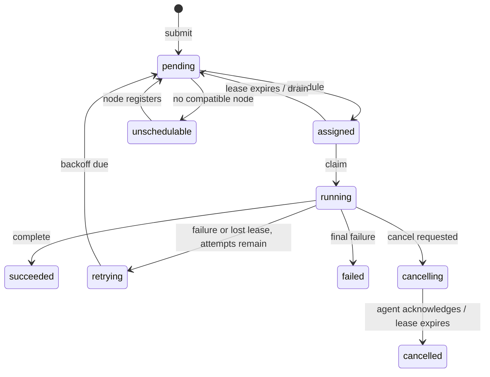

# Control-plane lifecycle — LLD

**Code:** `internal/controlplane/`, `internal/job/`, and
`cmd/controlplane/main.go`.

`main.go` wires PostgreSQL, S3, HTTP, gRPC, metrics, the control-plane loop,
and the optional local capacity/provisioner loops. `Service` owns submission,
claim, completion, failure, cancellation, retry, and lease expiry. `job.Status`
defines permitted transitions, while SQL predicates enforce the persisted
state that must be true for each update.

**Submission.** `Submit` validates a version-backed specification, inserts a
job and `submitted` event in one transaction, then returns. A repeated ID
with the same version, priority, and canonical JSON input returns the stored
job; a changed specification conflicts. A one-slot wakeup channel coalesces
notices. The periodic one-second pass remains the recovery path if a notice
is missed.

**Assignment.** The control-plane loop reconstructs free resources from
nodes and active jobs, asks the scheduler for placements, then conditionally
updates `pending` jobs to `assigned` with a 30-second lease and increments
their attempt. `Claim` advances one assignment to `running`, returns that
attempt, and records an event in the same transaction.

**Finish and retry.** `Complete`, `Fail`, and `Cancel` reject stale attempts.
Failure checks `execution_attempts` against the version's `max_attempts`;
eligible jobs enter `retrying` until `next_attempt_at`. A one-second loop
releases due retries and expires leases. Cancellation of running work is
observed by the agent on lease renewal.

**Process-local state.** `RuntimeState` records last heartbeats; PostgreSQL
stores node registrations and leases. A control-plane restart loses heartbeat
history until agents re-register. In-memory metric timestamps likewise do
not survive a restart.

The `Service` mutex serializes several lifecycle operations and scheduling.
This simplifies the current single-process prototype but is not a
multi-replica coordination mechanism.
