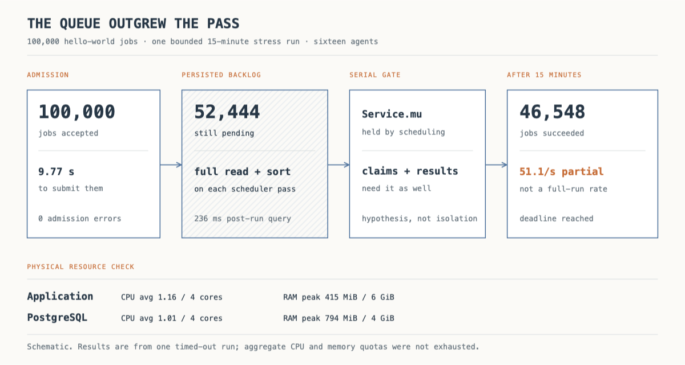

# What 100,000 hello-world jobs revealed about mini-modal

Mini-modal accepted **100,000 function calls in 9.77 seconds**. Fifteen minutes later, only **46,548 had finished**; **52,444 were still pending**. After I bounded each scheduler pass, a repeat run finished **all 100,000 in 503.6 seconds**. The function just printed a greeting and returned it. The size of the pending queue had exposed the expensive part of scheduling.

The first run was incomplete, not a 100,000-job throughput result. I stopped it at the 15-minute observer deadline. The repeat did finish, but these are diagnostic runs on a shared host, not a controlled production comparison.

## The experiment

Each call created a real job for one uploaded Python function version. Sixteen agent processes claimed jobs, downloaded the artifact, started Python through the host-process executor, uploaded logs, and reported results. No fake executor and no Docker container per greeting.

The control plane, agents, and load generator shared a container limited to **4 CPUs and 6 GiB**. PostgreSQL ran separately with **4 CPUs and 4 GiB**. I reset the dedicated benchmark database for each run. Agents advertised 64 CPUs and 128 GiB each for placement; those were logical limits, not extra physical resources.

At 2,048 jobs, eight agents averaged **157 completions/s** over three runs. Their 50-ms claim interval gives a rough ceiling of 160 starts/s, so I tried sixteen agents. That raised the average to **266/s**. At 10,000 jobs, sixteen agents averaged **235/s**, and all jobs completed. The average job p99 was **41.55 seconds**—mostly queue time for a short function.

At 100,000 jobs, successful completions across the observed window fell to **51.1/s**. App CPU averaged only **1.16/4 cores**; PostgreSQL averaged **1.01/4**. Peak memory was **415 MiB** and **794 MiB**, respectively. More advertised node capacity would not fix this.

## The queue was expensive to inspect

Every scheduler pass read *all* eligible pending jobs, sorted by priority, then tried to place them. It held a service mutex through that work. Claims and completions also needed the mutex. A pass that was cheap with a small queue became a long critical section with tens of thousands of pending rows.

One metrics snapshot counted **2,335 scheduler passes taking 632 seconds** in total. A post-run query took **236 ms** to read and sort the remaining 52,444 pending jobs, spilling about 4 MiB to temporary disk. The run also recorded **640 expired assignment leases**: reserved jobs that agents did not claim before their lease ended. Those measurements point to scheduling and claim contention, but I have not isolated mutex wait time yet.

I changed the scheduler to read **10,000 jobs per pass** using a priority-ordered cursor and an index for pending jobs. The cursor advances past jobs that cannot fit right now, so the same head of the queue cannot hide later work forever. It wraps to the highest priority when it reaches the end. Postgres-backed tests cover both advancing and wrapping.

With the same container limits and sixteen agents, the repeat accepted 100,000 jobs in **8.61 seconds** and completed them at **198.6/s**. App CPU averaged **3.04/4 cores**. A scheduler pass averaged about **33 ms**, down from about **270 ms** in the first run's snapshot. The result is consistent with the bounded scan helping, but host load and the uncommitted code state prevent a clean causal claim.

The system is not “fixed.” Job p99 was still **492 seconds**, and **11,307 assignment leases expired** during the completed burst run. In a three-run, 20,000-job agent sweep, sixteen agents averaged **247 completions/s**; twenty and twenty-four did not improve it. On a 100,000-job paced run, **218 delivered submissions/s** kept the pending queue flat, while **240/s** built a backlog. Those long runs each happened once, and the load generator shared the app's four-core quota. They bracket this benchmark box's observed capacity, not a production limit.

Long queueing, assignment churn, and the mutex shared with claims still deserve separate measurement. Fast admission is not the same as keeping accepted work moving.

The [benchmark method and raw results](../benchmark-hello-process-2026-10-03.md) and [architecture notes](../architecture/README.md) contain the details.
